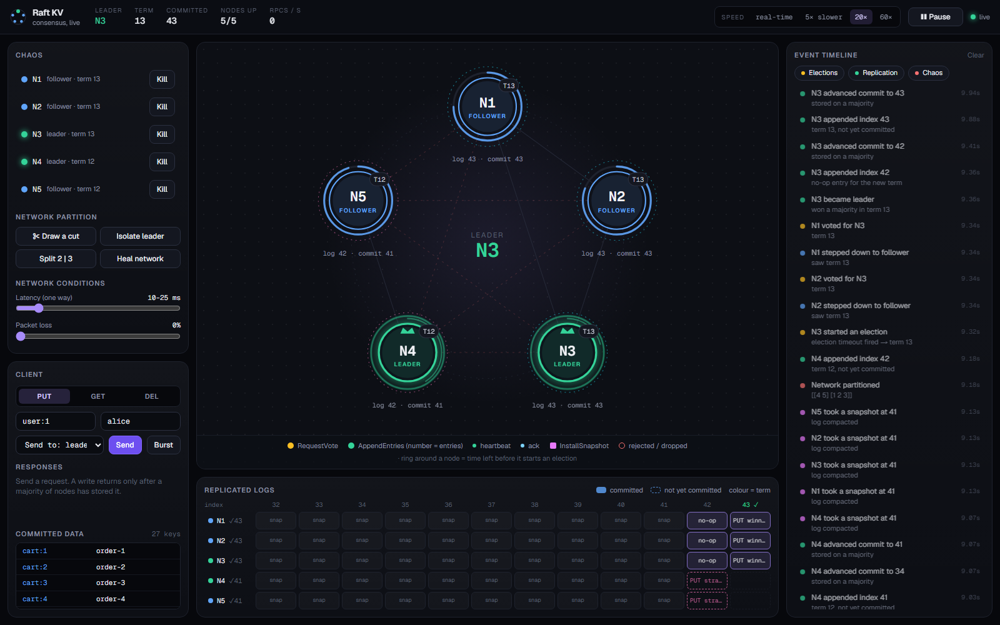
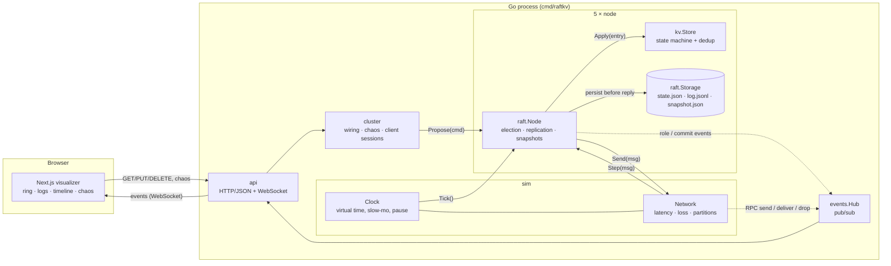
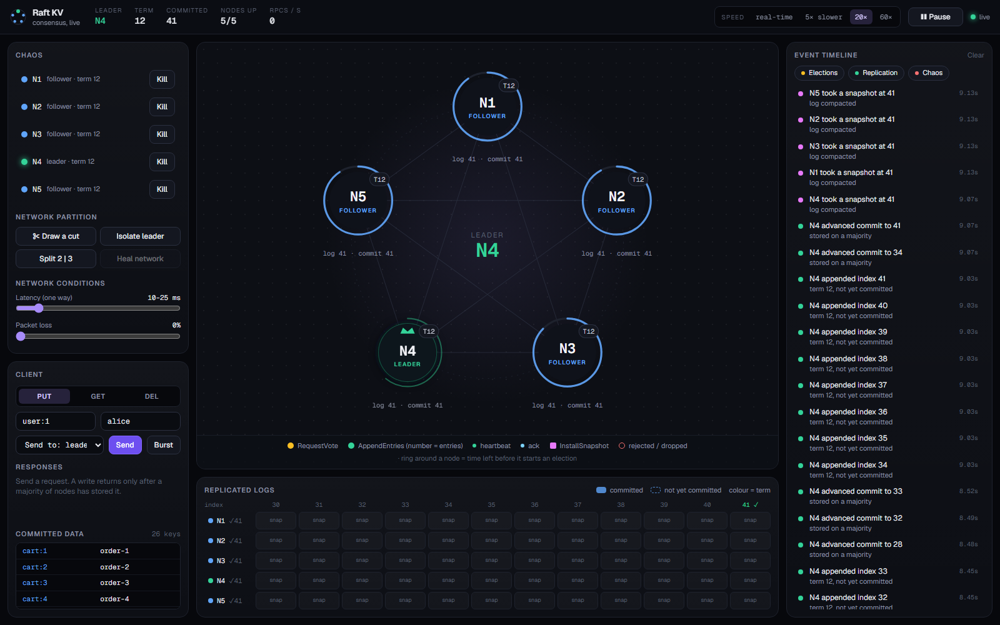

# Raft KV — a distributed key-value store with a live consensus visualizer

A linearizable key-value store replicated across 5 nodes with **Raft, implemented from scratch in Go** (no consensus library), plus a web UI that shows the cluster thinking in real time: elections, heartbeats, log replication, commits, crashes and network partitions.



*A 2 | 3 network partition. N4 (term 12) is stranded on the minority side and still believes it is leader; its write (`PUT stra…`, dashed) can never commit. The majority elected N3 in term 13 and keeps committing. Healing the network makes N4 step down and discard the dashed entry.*

## What it does

| | |
|---|---|
| **Raft core** | Leader election, log replication, commit index, crash-safe persistence of term / vote / log, log compaction with snapshots and `InstallSnapshot`, fast log backtracking |
| **KV store** | `GET` / `PUT` / `DELETE` over HTTP/JSON. Linearizable. Followers answer `307` redirecting to the leader. Retries are exactly-once (client sessions + sequence numbers) |
| **Chaos** | Kill / restart any node, partition the network (draw a line across the cluster), add latency, drop packets, slow time down 60×, pause |
| **Visualizer** | Next.js + TypeScript + Tailwind + Framer Motion. Every RPC is animated; election timers, per-node logs, commit index and an event timeline update live over a WebSocket |
| **Tests** | Election safety, re-election, log consistency across partitions, persistence, snapshots, and a linearizability checker run against a chaos test |

## Quick start (Windows)

Requirements: [Go](https://go.dev/dl/) 1.22+ and [Node.js](https://nodejs.org/) 20+.

```powershell
./start.ps1
```

That builds the UI (first run only), builds the server, starts a 5-node cluster and opens <http://localhost:8080>. Options: `-Fresh` (wipe data), `-Scale 1` (real time instead of 20× slow motion), `-RebuildWeb`.

Things to try in the UI:

1. **Kill the leader** → watch a follower's timer run out, votes fly, a new leader appear.
2. **Split 2 | 3** → two leaders in different terms; send a write to each side (pick the node under *Send to*).
3. **Heal network** → the stale leader steps down and its uncommitted entries are discarded.
4. **Burst** → 20 concurrent writes get batched into a few `AppendEntries` messages.
5. Kill a follower, **Burst** three times, restart it → it is so far behind that it receives a snapshot.

Manual start / other platforms:

```bash
cd web && npm install && npm run build && cd ..
go run ./cmd/raftkv            # then open http://localhost:8080
```

### HTTP API

```bash
curl -X PUT -d "alice" localhost:8080/api/kv/user:1          # routed to the leader
curl localhost:8080/api/kv/user:1
curl -i -X PUT -d "bob" "localhost:8080/api/kv/user:1?node=2" # ask a specific node: 307 if it is a follower
curl -X DELETE localhost:8080/api/kv/user:1

curl -X POST localhost:8080/api/nodes/3/kill
curl -X POST localhost:8080/api/nodes/3/restart
curl -X POST -H "Content-Type: application/json" -d '{"groups":[[1,2],[3,4,5]]}' localhost:8080/api/network/partition
curl -X POST localhost:8080/api/network/heal
curl -X POST -H "Content-Type: application/json" -d '{"latencyMinMs":20,"latencyMaxMs":80,"dropRate":0.1}' localhost:8080/api/network/conditions
```

`GET /api/state` returns the full cluster state; `GET /ws` streams events.

### Tests and benchmark

```bash
go test ./...                               # ~15 s, includes the chaos + linearizability test
go run ./cmd/bench -out docs/BENCHMARK.md   # ~45 s
```

## Architecture



**Life of a write.** `PUT x=1` → `api` → `cluster.Do` picks a client session and calls `Propose` on the leader → the leader appends the entry, writes it to its WAL, and sends `AppendEntries` → each follower checks `prevLogIndex/prevLogTerm`, appends, persists, acks → when a majority has it the leader advances `commitIndex`, applies the entry to its `kv.Store`, and the waiting HTTP request returns → followers learn the new commit index from the next `AppendEntries`.

| Package | Role |
|---|---|
| [`raft/`](raft) | The algorithm. `raft.go` (node), `storage.go` (disk), `types.go` (messages). Knows nothing about HTTP, KV or the simulator |
| [`sim/`](sim) | Virtual clock/scheduler and a fault-injecting in-memory network |
| [`kv/`](kv) | The replicated state machine with exactly-once sessions |
| [`cluster/`](cluster) | Glues N nodes together; chaos controls; the retrying client; the test suite |
| [`checker/`](checker) | Linearizability checker (Wing & Gong search with memoization) |
| [`events/`](events), [`api/`](api) | Event hub; HTTP + WebSocket server |
| [`cmd/raftkv`](cmd/raftkv), [`cmd/bench`](cmd/bench) | Server and benchmark binaries |
| [`web/`](web) | The visualizer |

A file-by-file walkthrough is in [docs/STUDY_GUIDE.md](docs/STUDY_GUIDE.md).

## Screenshots

| Healthy cluster replicating writes | Partition: split brain, contained |
|---|---|
|  |  |

> **Demo GIF:** record one with [ScreenToGif](https://www.screentogif.com/) (free): kill the leader → wait for the election → *Split 2 | 3* → *Heal*. Save it as `docs/screenshots/demo.gif` and add `` at the top of this file.

## Measured performance

From [docs/BENCHMARK.md](docs/BENCHMARK.md) — 5 nodes, real-time clock, 1–3 ms simulated one-way latency, every write persisted and majority-committed (14-core laptop, Windows, Go 1.27):

| Concurrent clients | Throughput | p50 | p99 |
|---:|---:|---:|---:|
| 1 | 207 ops/s | 4.8 ms | 6.4 ms |
| 32 | 5,259 ops/s | 5.9 ms | 16.2 ms |
| 128 | 14,838 ops/s | 6.5 ms | 38.2 ms |

Leader failover over 15 trials: new leader elected in **170 ms median (261 ms worst)**; first successful client write **178 ms** after the crash.

Throughput grows ~70× from 1 to 128 clients while median latency stays flat, because the leader batches every command that arrives during a round trip into a single `AppendEntries`.

## Design decisions

- **Message passing, not blocking RPCs.** The node has two inputs, `Tick()` and `Step(msg)`, and one output, `Send(msg)` (the etcd/raft shape). No goroutine per RPC, no timers inside the algorithm. This is what makes it possible to run the same code under a simulated network, slow it down 60×, and show every message in the UI.
- **Persist → apply → send.** Every `Tick`/`Step`/`Propose` ends in `ready()`, which writes term/vote/log to disk *before* any reply leaves the node. A vote or an ack is a promise that must survive a crash.
- **Append-only WAL + atomic renames.** The common path appends new entries to `log.jsonl`; only truncation and compaction rewrite the file (to a temp file, then rename). A torn final line after a crash is ignored on recovery — it was never acknowledged.
- **No-op entry on election.** A new leader cannot count replicas to commit entries from older terms (Raft paper, Figure 8). Appending an empty entry in its own term lets it commit everything before it immediately.
- **Batching with one in-flight `AppendEntries` per follower.** New commands for a busy follower wait and go out together when its ack arrives. The heartbeat doubles as the retransmission timer, so lost messages need no extra machinery.
- **Fast log backtracking.** A rejecting follower returns the conflicting term and its first index, so the leader skips a whole term per round trip instead of one entry.
- **Reads go through the log.** A partitioned ex-leader cannot serve a stale read because it cannot commit. Simple and obviously correct; the cost is a log write per read (ReadIndex / leases would avoid it).
- **Exactly-once writes.** Each command carries `(client session, sequence)`. The state machine remembers the last sequence and result per session — and includes that table in snapshots — so a retried request is never applied twice.
- **Simulated network with per-link FIFO.** Real Raft runs over TCP, which does not reorder. The simulator keeps messages on one link in order but can delay, drop and partition them, deterministically enough to test.

## Guarantees

Verified by the test suite (`go test ./...`), including a chaos test that crashes nodes, partitions the network and drops 5% of packets while concurrent clients run:

- **Election safety** — at most one leader per term (asserted on every role change; the node also panics if it ever sees a second leader in its term).
- **Log matching / state machine safety** — after every scenario, all overlapping log entries are identical and all replicas hold identical data.
- **Leader completeness in practice** — acknowledged writes survive leader crashes, full-cluster restarts and partitions.
- **Linearizability** — the recorded client history (~200 operations per run, including timed-out writes whose outcome is unknown) is checked by a Wing & Gong style checker.
- **Availability** — the cluster makes progress with any 3 of 5 nodes connected, and refuses writes (rather than diverging) with fewer.

## Limits (what this is not)

- **One process, simulated network.** Nodes are objects in a single Go process talking through an in-memory network, not separate machines over TCP. The Raft core only depends on a `Send(Message)` function, so a real transport is a drop-in, but it is not built.
- **No cluster membership changes.** The set of 5 nodes is fixed (no joint consensus / single-server changes).
- **No PreVote or CheckQuorum.** A node returning from a partition has a higher term and forces one unnecessary election; an isolated leader keeps believing it leads (safely — it cannot commit) until it hears a higher term.
- **`fsync` is off by default.** Writes survive a process crash but not necessarily a power cut. `-fsync` turns it on at a large throughput cost.
- **Snapshots are sent in one message** and the whole state is serialized as JSON — fine for a demo, not for gigabytes.
- **Reads are not optimized** (no ReadIndex, no leases, no follower reads).
- **Client session table never expires.**
- **Not checked with the Go race detector** on this machine (it needs a C compiler on Windows). Run `go test -race ./...` on Linux/macOS or with gcc installed.
- **No authentication or TLS.** The chaos endpoints are open; do not expose this to the internet as anything but a demo.

## Deploying

The Go binary serves the UI, so one container is the whole app. See [docs/DEPLOY.md](docs/DEPLOY.md) for step-by-step Fly.io and Vercel instructions.

## References

- Ongaro & Ousterhout, [*In Search of an Understandable Consensus Algorithm*](https://raft.github.io/raft.pdf) (extended version)
- Ongaro, [*Consensus: Bridging Theory and Practice*](https://github.com/ongardie/dissertation) (PhD thesis)
- [etcd/raft](https://github.com/etcd-io/raft) for the Tick/Step design; MIT 6.5840 for the test ideas
